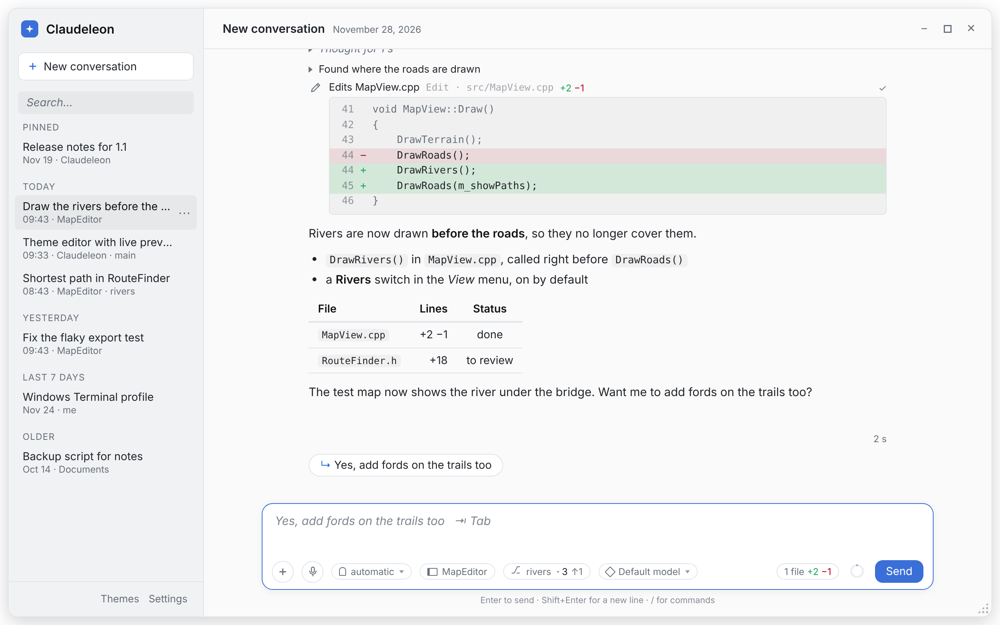

# Claudeleon

A themeable desktop app for working with Claude Code: it changes its skin like a chameleon, the conversation stays
the same. *(Italiano più sotto.)*

<picture>
  <source media="(prefers-color-scheme: dark)" srcset="docs/claudeleon-dark.png">
  
</picture>

**Install:** download `Claudeleon-Setup-<version>.exe` from the
[latest release](https://github.com/LukePasax/Claudeleon/releases/latest) and run it; from then on it updates itself
from the releases. You need [Claude Code](https://docs.anthropic.com/en/docs/claude-code) installed and signed in.
The installer is not signed: if Windows says "Windows protected your PC", choose "More info" → "Run anyway".

**What it does:** Claudeleon drives Claude Code through the Agent SDK, in a window as large as the desktop app, with
much of what the desktop app does: several conversations at once, the conversation list (search, pin, archive,
export), attachments and `@` file mentions, slash commands, permission prompts and plan mode, visible reasoning,
context and plan usage, changed-files summary with diffs and line comments for Claude, git (branches, commit, push,
pull requests, a separate worktree per conversation), a live preview of local dev servers, claude.ai artifacts (a card in the conversation, the page in a side panel,
the list of those you published), background tasks, MCP
servers and plugins, permission rules, memory (`CLAUDE.md`), notifications, dictation (Windows voice typing) and
automatic updates.

**Themes:** it ships with *Essential*, clean and neutral, light or dark like Windows. You can create themes with the
built-in editor (colors, font, corners, with a live preview), export any theme to a `.skin` file and import themes
others made — even ones with a shape all their own (themes with code ask for confirmation before installing). Or
just ask Claude in a conversation ("make me a theme like…"): Claudeleon teaches it how, and the theme appears live.

**Language:** English by default, Italian in Settings → General → Language.

**From the repo:** double-click `avvia.cmd` to run it without installing, or `crea-installer.cmd` to build the
installer (`claude-skins\app\dist\Claudeleon-Setup-<version>.exe`). You need [Node.js](https://nodejs.org) LTS.
Releases are built by the "Release" GitHub Action (Actions → Release → Run workflow), after raising the version in
`claude-skins/app/package.json`.

Documentation:
- [User guide](docs/user-guide.md): install, updates, conversations, git, preview, settings, themes, shortcuts.
- [Writing a theme](docs/themes.md): layout, drawings, hooks, colors, the modern kit, `.skin` files.
- In Italian: [`LEGGIMI.md`](claude-skins/app/LEGGIMI.md) (use) and the
  [theme guide](claude-skins/app/src/renderer/themes/LEGGIMI.md); [`CONTESTO-PER-CLAUDE.md`](claude-skins/CONTESTO-PER-CLAUDE.md)
  has the history and design choices.

---

## Italiano

Un'app a temi per lavorare con Claude Code: cambia pelle come un camaleonte, la conversazione resta quella.

**Per installarla:** scarica `Claudeleon-Setup-<versione>.exe` dall'[ultima release](https://github.com/LukePasax/Claudeleon/releases/latest)
e lancialo; poi si aggiorna da sola dalle release. Per un tema nuovo basta chiederlo a Claude in una conversazione
("fammi un tema come…"): Claudeleon gli insegna come si fa e il tema compare subito. Serve Claude Code installato, col login fatto. La lingua di
partenza è l'inglese: l'italiano si sceglie da Impostazioni → Generale → Lingua.

Dal repo: doppio clic su `avvia.cmd` per aprirla senza installare, o su `crea-installer.cmd` per farsi l'installer
(`claude-skins\app\dist\Claudeleon-Setup-<versione>.exe`). Serve [Node.js](https://nodejs.org) LTS. La guida
d'uso in italiano è [`LEGGIMI.md`](claude-skins/app/LEGGIMI.md), quella per scrivere temi è
[`themes/LEGGIMI.md`](claude-skins/app/src/renderer/themes/LEGGIMI.md).
